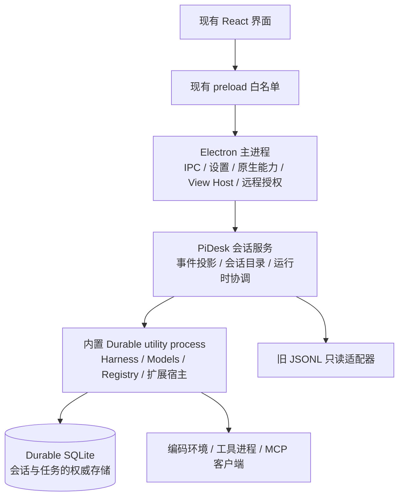

# PiDesk 内置 Durable 迁移方案

状态：方案草案，尚未替换运行时。工作分支：`trans-to-durable`。

## 1. 已确认的目标与边界

- `pi-durable` 随 PiDesk 安装包交付；使用者不再安装、配置或升级 pi CLI。
- 新会话全部由 Durable 执行，不保留 pi RPC 作为备用执行路径。
- 前端布局、文档流、工具摘要、输入栏、工作台与 View 槽位整体保留；允许调整数据适配和少量具有旧运行时语义的控件。
- 旧 pi JSONL 历史仅供查看，不导入为可续接的 Durable 会话，也不通过旧 pi 进程继续执行。
- 本轮只规划，未安装新依赖、修改业务代码或修改相邻扩展仓库。

依据：当前 PiDesk 源码、相邻 `pi-learn` 源码、相邻 `MyPiExtension` 的扩展示例，以及 npm 发布包的 README / `.d.ts`。发布包核对版本为 `@earendil-works/pi-durable`、`pi-ai`、`pi-mcp` **1.6.0**；相邻 `pi-learn` 的 Durable 是 **1.4.0**，不能直接把它的 API 当作目标版本。

Durable 的发布说明仍标为 Experimental。实施时固定精确版本，由适配层消化上游变化；升级需要重新核对存储、task、signal 和模型接口。

## 2. 核心结论

Durable 能承担 agent 执行内核：模型回合、编码工具、插话与后续输入、压缩、持久化、任务恢复、子会话、用量以及交互等待。现有 React 工作台可以保留。

Durable 不是完整的 pi coding-agent 应用。pi 的扩展加载器、命令系统、技能发现、MCP 管理、UI 上下文和 CLI 包管理不会随着 `Harness.open()` 自动出现。这些应用层能力要由 PiDesk 接管，或通过独立的 pi 库实现。

真正不能直接兼容的是旧 pi 扩展的执行契约、TUI 组件、原生 JSONL 的可写互通、pi CLI 命令，以及“一会话一个 pi PID”的管理方式。不能把这些入口接上空实现后宣布兼容。

## 3. 内置架构建议

建议用 PiDesk 自己管理的 Electron utility process 承载 Durable。它加载随应用编译和打包的 TypeScript 运行时入口，不启动 `pi --mode rpc`，不依赖用户安装的 Node 或 pi 可执行文件。这个进程是 PiDesk 的内部运行时；“内置”不要求所有代码都在 Electron 主线程执行。

推荐一个应用级运行时进程，按顶层会话打开独立 Harness / SQLite；同一个 Harness 内的子代理继续使用 Durable conversation 和 task。这样一个会话的存储错误只终结它所属的 Harness，utility process 崩溃仍会影响该进程中的全部会话，需要协调恢复。

选择进程隔离的原因是第三方扩展、SQLite 和工具宿主可能阻塞或崩溃。直接在主进程嵌入也可实现，但会扩大对窗口、原生回调和 IPC 的影响。utility process 本身不是安全沙箱；扩展权限仍需宿主约束。

### 模块职责（以下名称均为拟新增，并非现有 API）

| 模块 | 职责 |
| --- | --- |
| `agentRuntime/` | 内置进程入口、Harness 管理、生命周期、关闭和故障恢复 |
| `agentRuntime/models/` | pi-ai providers、模型目录、自定义网关、凭证访问、OAuth |
| `agentRuntime/extensions/` | Durable 扩展加载、命令、生命周期、资源发现和兼容诊断 |
| `agentRuntime/interactions/` | 待答交互的持久状态、signal、取消、超时、桌面和手机答复 |
| `agentRuntime/environment/` | cwd、文件与进程执行、shell、输出保留、进程归属 |
| `agentRuntime/mcp/` | MCP 连接、工具注册、资源、OAuth、重连和配置作用域 |
| `session/durableProjection` | Durable entries / live / inbox 到现有前端消息与事件的投影 |
| `session/sessionRepository` | Durable 新历史与旧 JSONL 只读历史的统一查询入口 |

实现时不能继续用 `spawnInstance`、`childAlive`、RPC readiness 探针等名称掩盖新的语义。对外保留必要 IPC，对内更新职责清晰的接口。

## 4. 现有功能逐项评估

“可适配”表示底层能力存在，仍需实现和验证，不能视作迁移已完成。

| 现有功能 | Durable / 独立库能力 | PiDesk 所需工作及前端影响 |
| --- | --- | --- |
| 文本、思考和工具调用流 | conversation watch、`pi.live`、assistant entries | 将状态投影成现有 delta / message_end；保留文档流组件 |
| 工具摘要、错误和嵌套工具 | tool entries、slots、`nestedTools`、diagnostics | 转换 output/details、父调用 ID、错误与耗时；已有状态行可用 |
| 图片附件与 read 图片 | 图片输入、CodingTools、Photon / fit 扩展 | 对齐模型限制、图片错误、WASM / worker 打包；保留附件 UI |
| 插话 / 稍后队列 | `submit` 的 `whenBusy`、inbox、submission abort | 映射队列意图和全量快照；清空仅撤销目标排队项，不能误中断当前 run |
| 停止、重试、继续执行 | abort、continue、retry、runFailure | 区分关闭、用户中断和崩溃；继续执行不能冒充新用户提问 |
| 多会话并行 | 多 Harness / conversation | 保留 SessionId 路由和并发限制，限制对象改为已打开的运行时会话 |
| 上下文压缩 | 自动 / 手动 compact、compaction 状态 | 映射压缩过程、失败与摘要；旧扩展专用标记需单独迁移 |
| 模型列表、切换、思考档位 | pi-ai Models、conversation configure | 移除短连 pi RPC；模型能力与档位归一继续由适配层处理 |
| API Key、多凭证、自定义网关 | pi-ai CredentialStore、provider factories | 保留现有设置 UI；重做凭证后端和 provider 注册，不依赖旧 registerProvider |
| 模型 OAuth 登录 | pi-ai 提供 provider auth 能力 | PiDesk 负责浏览器交互、取消、refresh 协调及持久化，需按 provider 验证 |
| 会话标题、归档、置顶、排序 | Durable 可保存宿主 document；列表是应用职责 | 保存稳定会话 ID 与摘要；旧以文件路径为 key 的偏好需要显式映射 |
| 历史恢复和分页 | SQLite、entries 分页、ConversationTranscript | 增加 Durable repository；旧 JSONL 仍由旧只读 reader 读取 |
| Markdown 导出 | 现有 PiDesk 转换器可复用 | 统一 transcript 后复用，包含自定义通知和工具结果 |
| HTML 导出 | 没有旧 `export_html` / `pi --export` 接口 | PiDesk 内置导出器；旧扩展提供的专有 HTML 渲染不能自动继承 |
| slash commands / 技能 / 模板 | registry 不包含 pi 命令和资源加载器 | 自建 command / resource 服务，保留补全菜单；本地命令不可误发给模型 |
| AGENTS.md / 系统指令 | sections、instructions | PiDesk 负责发现范围、优先级、加载与刷新；不应只安装 CodingTools 就开跑 |
| Plan / 访问模式 | configure tools / extensions、ToolTask gate | 保留模式芯片和 View 协议；工具限制必须在宿主执行时落实 |
| 扩展 select / confirm / input / editor | signal、工具 park、task sleep 提供底层等待 | 重做交互宿主，可复用现有对话框；详见第 7 节 |
| View SDK 八类槽位 | PiDesk 自有协议，独立于 Durable | 保留前端 View 渲染和宿主协议，修改身份绑定与生命周期 |
| MCP 配置、市场、工具状态行 | pi-mcp 支持 stdio / HTTP、OAuth、工具转换 | 保留页面；连接、工具桥接、资源、状态和登录改由内置宿主管理 |
| Code mode / 延迟工具搜索 | Durable codemode / tool-search | 安装并配置对应扩展，映射 namespace、嵌套工具及 structuredOutput |
| 定时任务 | Durable 可执行输入和持久 task | 保留现有调度服务，改用新会话接口；等待真正 idle，不以回答完成代替任务完成 |
| 用量统计与趋势 | `pi.usage`、entry usage | 新历史读取 Durable；旧历史保留 JSONL 扫描；按来源去重，不能混加总量与明细 |
| 手机授权、发送、中断、交互答复 | PiDesk 自有 remote v2 协议 | 保留授权与 scope 校验；更换历史源、稳定 cursor 和交互后端 |
| 手机已完成批次同步 | Durable entries / 存储提交可提供权威边界 | 不同步 `pi.live` 临时值；保留完成工具组的边界和幂等续传 |
| 后台项目进程、日志与停止 | NodeExecutionEnv 可执行命令；不提供现有进程归属体系 | 自建可观测的执行环境 / bash 宿主；按实际 PID 与创建时间登记 |
| 预热、空闲回收、存活会话 | Harness open / close 和缓存策略 | 去掉进程预热探针；保留有意义的资源回收，等待交互和后台任务时不能误回收 |
| 文件、Office、PDF、终端、浏览器、Git 审阅 | 属于 PiDesk 工作台 | 大部分保留，核对向会话提交内容和工具编辑的连接点 |
| 主题、字号、语言、壁纸、更新、托盘 | 属于 PiDesk 桌面能力 | 保留；设置中移除 pi 可执行路径和 CLI 版本依赖 |

## 5. 保留前端的事件适配契约

优先保留 `window.pidesk` 和 `{ sessionId, type: event | eventBatch | exit | error, payload }` 的推送外形，在主进程服务边界做投影。`PiAgentEvent` 可先保留为兼容类型，随后改为表达 PiDesk 自己的事件契约。

当前 `sessionTranscript.ts` 的 `message_update` 实际消费 `assistantMessageEvent` 的增量。只填入 `message` 快照不会更新正文，因此不能简单把 Durable watch.value 原样包装后发送。

投影需要满足：

1. 初次附着和重连先以权威 transcript 和 live snapshot 水合，不补发已显示内容的 delta。
2. 按 conversation、generation attempt、entry、tool call 建立身份；新 attempt 不能续写上一次失败文本。
3. 正常追加时将 text / thinking / tool arguments 的状态差转换成原有增量；无法按前缀追加时，通过明确的重置 / 对账路径替换，不能直接拼接。
4. 正式 assistant / tool entries 到达后发送一次权威完成事件；重复订阅和重连不得重复累计 usage。
5. watch 会合并回调期间的多个提交，仅靠相邻 `pi.live` 快照可能漏掉已经开始又结束的工具。完整历史边界应从存储提交和 entries 补齐，而不是猜测短暂状态。
6. `Submission.wait()` 在答案提交时即可完成，`afterRun` 任务还可能继续。只有 run、前台子工作与相应队列达到终态，才能投影现有 `agent_settled`。
7. live partial 允许 deferred persistence。桌面可展示它，手机历史同步和最终完成判断只读已经存储的权威数据。
8. 保留现有约 32ms 前端推送合批；Durable 自身 partial 节流另有配置，不能承诺完全相同的逐 token 时间间隔。
9. 从 SQLite 分页补齐长历史；watch 默认只含最新窗口，不能把该窗口当作完整会话。
10. utility process 的消息需类型校验、大小限制、请求 ID、超时及关闭结算；不再解析 pi stdout JSONL。

## 6. 扩展适配策略

### 6.1 区分三种契约

- **Durable agent 扩展**：工具、sections、hooks、wraps、tasks，安装进 registry。
- **PiDesk 宿主扩展**：commands、settings、View、notifications、资源、项目与会话生命周期。应有显式注入的宿主上下文。
- **旧 pi 扩展**：`export default (pi: ExtensionAPI) => ...`。不能直接当作 Durable Extension 安装。

建议以 Durable 原生扩展与 PiDesk 宿主 API 为正式目标，为实际使用的旧扩展提供范围明确的适配。不要预先承诺完整复刻 ExtensionAPI。未实现 API 在加载时给出诊断；不可静默 no-op。

新清单需要声明运行时、宿主 API 版本、作用域、入口、所需能力和贡献项。字段与 SDK 命名在实现前单独定稿；此方案不宣布新的公开 API 已可用。

同包支持 CLI 与桌面时可以提供两个入口，共享纯业务模块，分别连接 pi ExtensionAPI 和 PiDesk / Durable。避免长期维护一层把所有旧事件都伪装成原语的兼容框架。

### 6.2 旧 API 的映射与边界

| 旧扩展契约 | 迁移方向 | 兼容限制 |
| --- | --- | --- |
| `registerTool` | Durable defineTool / Extension.tools | 转换参数、output / structuredOutput / details、signal、progress、replay 策略；不是只改导入名 |
| `tool_call` / `tool_result` | ToolTask beforeTool / afterTool | 核对 hook 顺序、参数改写与审批绑定；持久等待用 signal |
| `before_agent_start` / context hooks | sections、configure、GenerationTask hooks | 请求级改写和持久配置语义不同，按扩展业务迁移 |
| `agent_before_settle` | onYield / afterTools / 宿主工作协调 | 旧事件的时机和续跑规则没有一对一保证 |
| `session_start` / shutdown | PiDesk 显式生命周期 | 区分打开、恢复、卸载、重载和崩溃；不靠假 RPC 触发 |
| `registerCommand` / input | PiDesk command router / input pipeline | 命令处理、补全、返回 handled、技能展开需要宿主提供 |
| `registerProvider` | pi-ai provider / Models | OAuth、缓存、请求和 stream 包装均需迁移 |
| `setActiveTools` / setModel / thinking | conversation configure | 保留每会话隔离；配置和运行中的请求何时生效必须明确 |
| `sessionManager.getBranch/getEntries` | conversation entries / context / fork | 不承诺旧 SessionEntry、叶子 ID 和 JSONL 路径语义兼容 |
| `appendEntry/sendMessage` | 自定义 Durable entry / submit write | 区分仅 UI 展示和模型可见内容，保留 display:false 语义 |
| `ctx.ui.select/confirm/input/editor` | PiDesk interaction service | 旧函数栈恢复不了；持久交互必须迁移为可恢复 task / parked tool |
| `ctx.ui.custom`、TUI renderers / editor | 现有 View 协议 / React | 无法直接执行终端组件；只能重写展示层 |
| header / widget / sidebar / footer / theme | PiDesk View 与主题令牌 | 已有 View 路径可迁移；终端 theme、ANSI、原始键盘事件不兼容 |
| `process.env` 中的会话身份 | 显式 host context / 每连接参数 | 多会话共享运行时，禁止动态修改全局 env 来切换会话 |
| `process.exit` / `ctx.shutdown` | 宿主会话关闭请求 | 不可允许关闭一条会话时终止共享运行时 |

### 6.3 相邻 MyPiExtension 的初步评估

以下来自源码抽样，表示适配方向，不代表这些包均已安装或完成兼容认证。

| 包 | 适配判断 |
| --- | --- |
| `yoki-web-tools` | 搜索与抓取逻辑可复用；工具注册、`/web-tools`、配置与桌面视图迁移 |
| `yoki-image-gen` | 生成请求与文件逻辑可复用；工具结果、模型接口、命令迁移 |
| `yoki-ask-user-question` | 优先迁移；保留已有桌面 View，改为持久问卷状态、park 与 signal；TUI 路径不加载 |
| `yoki-plan` | 优先迁移；用 configure / gate 实施工具限制，计划状态持久化；保存、确认和新会话流程迁移 |
| `pi-bash-jobs` | 工作量较大；进程生命周期、会话归属、输出日志与完成通知迁移；Durable 持久 task 不会让 OS 进程自动持久化 |
| `pi-telegram-main` | 工作量较大；桌面面板可复用，输入路由、会话历史、附件、绑定、生命周期和重复投递需逐项重做 |
| `yoki-newapi` | 工作量较大；迁移 provider 注册、网关模型、特殊压缩和请求逻辑；现有模型设置 UI 可继续使用 |
| `yoki-model-busy-retry` | 先核对 Durable retry 与 provider 行为；业务错误分类若有差异再迁移，避免两层重试叠加 |
| `yoki-skills` | SKILL.md 与资源可保留；安装器、发现、命令和技能面板由宿主接管 |
| `yoki-ui` | TUI header / editor / theme 无直接接入价值；PiDesk 已有对应 React 工作台 |
| `yoki-warp-notify` | Warp 终端协议不直接接入桌面；需要的通知场景映射到现有 PiDesk notification 服务 |
| `yoki-config` | 配置逻辑按使用者拆分；不能继续用旧 ExtensionContext 作为宿主依赖 |

## 7. View、交互与生命周期

### View SDK

保留 `view/v1` 的序列化节点、能力协商、八类 placement、patch、表单事件和现有 React 渲染。现有 View Host 本来就是独立宿主能力，Durable 不需要替代它。

需要改动：

- 注入按会话 / 扩展隔离的 client 与 contribution keys；不能继续依靠 `acquireProcessViewClient()` 代表一个会话。
- 现有进程级 SDK 单例和 `setSessionId()` 不能在共享进程内轮流绑定多个会话。可扩展 SDK 以支持显式连接参数与独立实例；旧 env 探测入口仅保留给仍使用它的独立宿主。
- 区分 session scope 与 application/settings scope。设置页不应为展示 UI 创建一个空模型会话。
- 现有 `extensionWorkerManager` 实际启动另一个 pi RPC，必须替换为 PiDesk 的扩展宿主生命周期，不能漏留这一条后台 pi 路径。
- 注册、关闭、扩展停用、升级、项目切换、utility process 崩溃均需要清理视图和撤销过期回调。
- View token 和原生服务留在宿主侧，渲染层不获得任意进程或文件系统能力。

### 持久交互

1. 工具或 gate 提交待答请求：稳定 requestId、conversationId、taskId、表单版本、期限及必要的展示状态。
2. 工具 park / task sleep，等待类型化 signal；禁止把 UI 回调 Promise 当作持久状态。
3. 桌面与手机展示同一请求。宿主校验会话归属、scope、请求版本和仍待答状态后调用 `harness.signal()`。
4. delivered / duplicate / closed 等结果映射为确定的答复；重试不产生第二次业务处理。
5. 重启后从持久状态重建待答列表，重新绑定 View；超时、中断、关闭和卸载各自明确结算规则。
6. 任意旧扩展 execute 函数的 JS 调用栈不能在崩溃后恢复。只经内存桥接的兼容交互应明确标注不支持恢复；问卷、权限 gate 等核心能力直接迁移。

Durable signal 的身份校验由宿主负责；不能把可写 signal 接口直接暴露给渲染层或手机。

## 8. 存储、旧历史与远程同步

### 新历史

建议每顶层会话一个 SQLite 文件，放在 PiDesk userData 下的受控目录，包含 Durable 自己的 schema 与 PiDesk 会话 metadata document。具体路径在实施前固定。会话目录索引只缓存可重建摘要，正文和任务只以 Durable 存储为准。

SQLite 由单一运行时持有写权限；主进程和手机同步通过 repository / runtime 查询，不另开一个可恢复任务的 Harness 抢占同库。关闭必须等待正在提交的事务和 deferred writes 刷新完成。

顶层会话隔离有利于故障、删除和备份边界，但跨顶层会话不具备 Durable 原子事务 / 同库 fork。子代理和需要原生 fork 的分支放在同一 Harness；跨文件复制若后续需要，应设计成显式导入。

需要稳定的公共 `SessionRef` 区分 Durable ID 和 legacy JSONL 引用。存储路径由主进程解析，不能把 UUID 伪装成 `.jsonl` 文件名以绕过现有路径校验。最终类型需同步更新 preload、共享协议和引用它的手机协议。

### 旧历史只读

保留现有路径校验、JSONL reader、分页 / 截断、自定义通知和 Markdown 转换。旧会话进入只读态：

- 查看、复制、引用、搜索、导出仍可用。
- 发送、继续、切模型、压缩、扩展激活和定时任务派发均拒绝；前端入口和主进程 / 手机操作同时限制。
- 归档、置顶等只改 PiDesk metadata。旧文件中的会话名不再通过 `appendSessionName()` 写入；如需重命名只增加宿主显示名。
- 本方案不包含删除旧源文件的行为；保留 / 隐藏旧记录和删除新 Durable 会话分开定义。
- 不自动生成旧对话摘要并带入新会话；如后续需要“引用后新建”，按用户显式操作设计。

### 远程 v2

保留配对、授权、scope、operationId 和现有操作账本。将远程 readAdapter 的 `.jsonl` 限制替换为 SessionRef 分派，仍由主进程校验已配置项目、会话归属和实际权限。

新历史 cursor 使用稳定的会话 / conversation / entry 或持久提交标识，不能再以文件偏移量代表 Durable 进度。需要版本化或协商 cursor 格式；旧 cursor 继续用于旧历史，不强行共用。

只同步已保存的完整消息 / 工具组。工具组边界要可从持久 transcript 重建；短暂 partial、内存投影和 run idle 通知不能作为正文已持久化的证明。保留失败 / 中断后的已保存结果。

## 9. MCP、模型凭证、进程和打包的关键点

### MCP

`@earendil-works/pi-mcp@1.6.0` 已提供独立 McpClient、stdio / Streamable HTTP、OAuth helpers、配置校验、工具命名、内容转换。可直接作为客户端基础，不必重写 JSON-RPC。

PiDesk 仍需实现配置合并与变量解析、项目根、连接共享范围、刷新锁、OAuth 状态保存、工具和资源桥接、通知更新、重连与停用。每个 server 可以对应一个 Durable Extension namespace；code mode 与 tool_search 使用相同的工具目录。

现有 `pi mcp list --json` 和 `/mcp login/logout/reconnect` 均替换为服务调用。配置页和市场可保留，但“pi 版本支持 MCP”的判断要变成内置能力查询。

### 模型与凭证

pi-ai 提供 Models、CredentialStore 和 provider auth，PiDesk 提供桌面登录与持久化适配。API Key、refresh token 不进入 renderer、会话正文或普通日志；复用 settings 模块与 safeStorage 的持久化边界。模型设置、网关和多凭证 UI 可以保留。

旧 `auth.json`、`models.json`、settings 的兼容需要定义格式和优先级；如提供导入，仅在用户显式选择后执行，不能依赖外部 pi 继续刷新凭证。本轮调查未读取任何实际凭证、设备秘密或 `.env`。

### 后台进程

目前 procService 通过每个 pi PID 及 bash 前后快照归属进程。共享 Durable 运行时后，所有会话共用父 PID，原方法会发生跨会话误认。

新执行环境 / bash 实现应在 spawn 时记录 `sessionId + conversationId + taskId + toolCallId + pid + creationTime`，并保留输出、取消和退出结果。不要把 utility process 的 PID 当作可单独结束某个会话的 PID。

后台服务和长作业的保留、停止、收养和日志尾随继续由 PiDesk 管理。工具崩溃重放策略默认保守，不能为了“恢复”而重跑外部写操作；read 等安全工具与外部副作用工具分别声明 replay 策略。

### 构建和运行前置验证

- Durable 1.6.0 要求 Node >= 22.19.0，包以 ESM 发布；现有主进程 tsc 输出 CommonJS。推荐独立的 ESM runtime 构建入口，维持现有 Electron main / preload 输出，不全仓改 module 类型。
- 内部传输用 Electron MessagePort，runtime 编译产物随安装包发布；开发入口纳入现有 watch / mtime 校验和重启编排。
- 新运行时依赖必须先在 AGENTS.md 登记，再安装；不把它们错误归类为只供渲染构建使用的 devDependencies。
- 验证 utility process 的实际 Node 版本、`node:sqlite`、ESM 加载、打包后 cwd 和资源定位。不是仅检查系统 Node。
- 本机 Electron 二进制已恢复，`pnpm check:agent-runtime` 已在 Electron 41.0.3 的 utility process（实际 Node 24.14.0）完成开发态与 `win-unpacked` / ASAR 中的 SQLite 关闭重开校验；依赖策略与实测边界见 [P0 验证记录](./P0-VERIFICATION.md)。这不等于完整迁移或 NSIS 安装流程已经验收。
- Photon WASM、图片 worker、QuickJS 和传递依赖的包体 / 路径必须做安装包验证；按需求加载，更新现有打包许可清单。
- 安装包必须在未安装 pi CLI 的机器验证全部功能，包含导出、MCP 探测、扩展设置页，避免遗留隐式依赖。

## 10. 分阶段实施与完成标准

这是交付顺序，不是在最终产品中保留两套可选会话引擎。

| 阶段 | 交付内容 | 完成标准 |
| --- | --- | --- |
| P0 内置可行性 | 固定版本、登记依赖、ESM utility process、SQLite、faux model、关闭 / 重开 | 开发态与打包态都能无 pi CLI 运行，崩溃后可恢复；确认包体与 Node 能力 |
| P1 会话与 UI 投影 | 新会话、流式、工具、队列、中断、重试、压缩、模型配置 | 现有 React 文档流正常；合并 watch、重连、失败 attempt、usage 去重均正确 |
| P2 历史与应用服务 | repository、旧历史只读、列表 metadata、导出、用量、定时任务 | 所有旧记录写入口关闭；新会话不再依赖 JSONL；任务按真实 idle 收口 |
| P3 扩展宿主与交互 | 新清单与 SDK 契约、commands、skills、AGENTS、View 生命周期、signal | 问卷和计划模式端到端可用，待答交互可重启恢复，settings 不启动 pi worker |
| P4 MCP 与常用扩展 | MCP 登录 / 重连 / 资源、网关、web、image、bash jobs、Telegram | 能力逐项验收并显示兼容状态；无旧 API 静默失败 |
| P5 手机与清理 | remote repository / cursor、旧记录只读权限、恢复竞态、删旧执行路径 | v2 手机同步和控制通过；全仓无任何调用 pi 可执行文件的业务路径 |

每阶段补充有意义的主进程纯逻辑 / 协议 Vitest，不引入渲染测试框架。关键验证覆盖：

- 重复提交 requestId、并发同会话打开、SQLite 单写者、关闭与提交竞态、崩溃恢复。
- 流式状态合并、工具快速完成、嵌套调用、失败重试、afterRun 后才 idle、usage 去重。
- 交互先答后 sleep、重复答、桌面和手机并发答、超时、中断、扩展卸载与应用重启。
- 工具修改文件后的 Git 审阅、跨会话 PID 归属、取消及后台服务保留。
- MCP 工具错误、structuredOutput、图片、OAuth 取消与 refresh、项目配置隔离。
- legacy 会话从桌面、定时任务和远程三条入口均无法继续执行或写回。
- 真正的 Windows 安装包上验证，无外部 pi / Node 环境也可运行。

## 11. 明确不做直接兼容的能力

1. 旧 pi ExtensionAPI 的任意扩展无需修改即可运行。
2. pi TUI 组件、自定义终端编辑器、ANSI 主题和 raw terminal input。
3. 新会话与 pi CLI 原生 JSONL 双向读写 / 续接。
4. `pi install/remove`、`pi mcp list`、`pi --export` 等外部 CLI 依赖。
5. 每个会话独立 pi PID，以及通过 kill 该 PID 关闭会话。
6. 旧扩展内存函数栈在进程崩溃后的透明恢复。
7. 依赖旧 SessionEntry / SessionManager 树语义的接口原样保留。

这些限制不意味着相关用户功能都要删除：工具、命令、View、MCP、计划、通知和问卷大多可以迁移；需要改写的是它们与旧 pi 宿主绑定的实现。

## 12. 实施前要替换的旧约定

用户已明确授权新的迁移方向；当前 AGENTS.md 中“仅 pi RPC”“不自建会话存储”和 README 中“不内置 pi”等表述属于旧架构约定。正式实现 P0 时应同步更新为此方案确定的契约，避免后续开发按相反规则推进。

不需要改掉文档流 UI、IPC 信封、主题令牌、View 安全边界、remote 授权和 pnpm / strict / Biome 规范。

下一步建议先完成 P0 和 P1 的实现设计，重点固定 runtime 进程协议、SessionRef、事件投影状态机；再定稿 PiDesk 扩展宿主 API 和问卷 / 计划两个迁移样例。以这些可运行样例验证接口后，再扩大到 Telegram、网关和后台作业。

## 13. 核对入口

仓库内主要依据：

- [piSession](../src/main/session/piSession.ts)、[sessionIpc](../src/main/session/sessionIpc.ts)、[runtimeCoordinator](../src/main/session/runtimeCoordinator.ts)
- [前端 transcript reducer](../src/renderer/stores/sessionTranscript.ts)、[共享 IPC](../src/shared/ipc.ts)、[贡献与生命周期](../src/shared/contribution.ts)
- [View SDK](../packages/view-sdk/README.md)、[View Host](../src/main/view/viewHost.ts)、[旧扩展 worker](../src/main/extension/extensionWorkerManager.ts)
- [旧历史 reader](../src/main/session/sessionTranscriptRead.ts)、[HTML 导出](../src/main/session/exportSession.ts)、[用量扫描](../src/main/usage/usageScanner.ts)
- [MCP 管理](../src/main/mcp/mcpIpc.ts)、[进程管理](../src/main/proc/procService.ts)、[远程数据源](../src/main/remote/desktopSource.ts)

上游发布包与文档：

- [pi-durable 1.6.0](https://www.npmjs.com/package/@earendil-works/pi-durable/v/1.6.0)
- [pi-ai 1.6.0](https://www.npmjs.com/package/@earendil-works/pi-ai/v/1.6.0)
- [pi-mcp 1.6.0](https://www.npmjs.com/package/@earendil-works/pi-mcp/v/1.6.0)
- [上游 Durable README（main 会变化，实施以锁定版本为准）](https://github.com/earendil-works/pi/tree/main/packages/durable)
