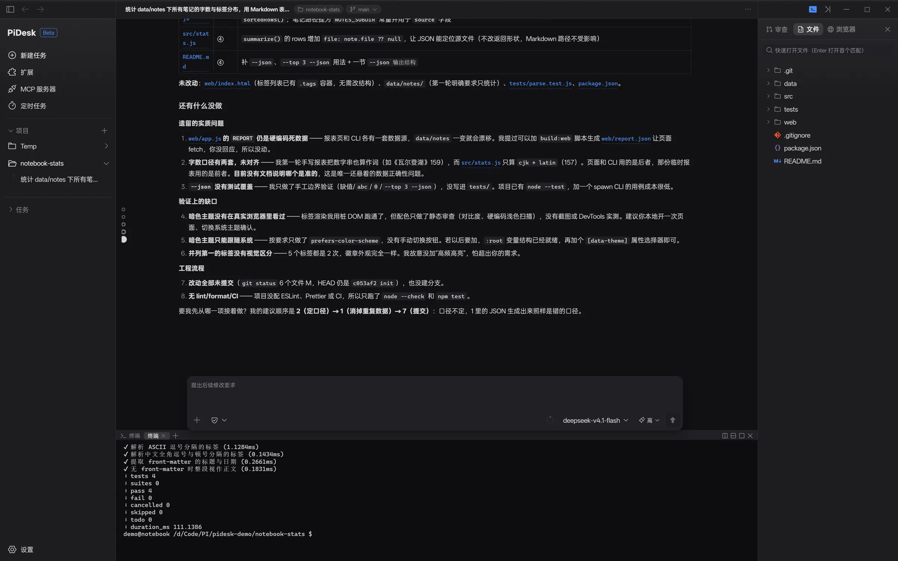
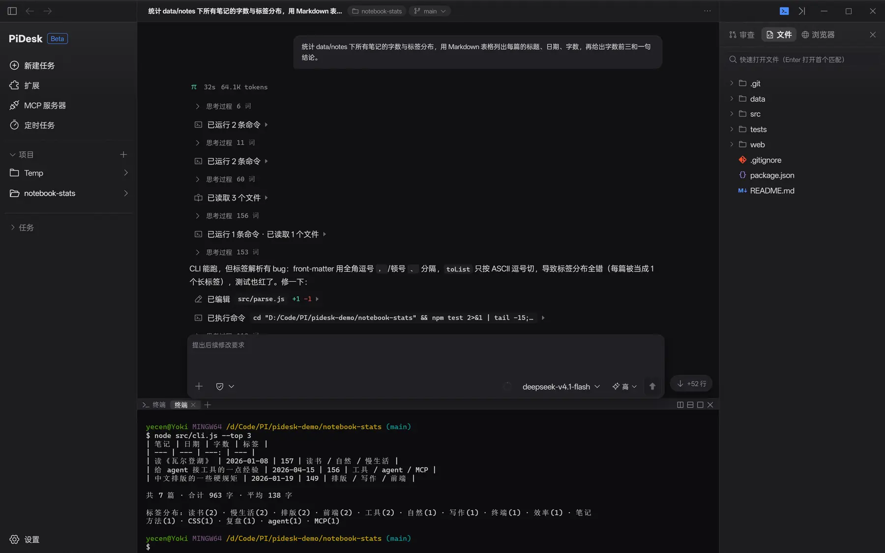
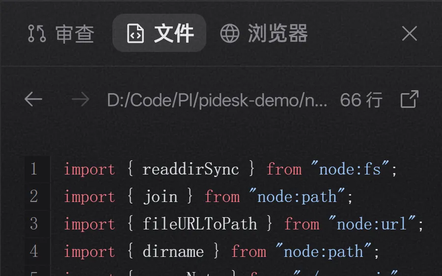
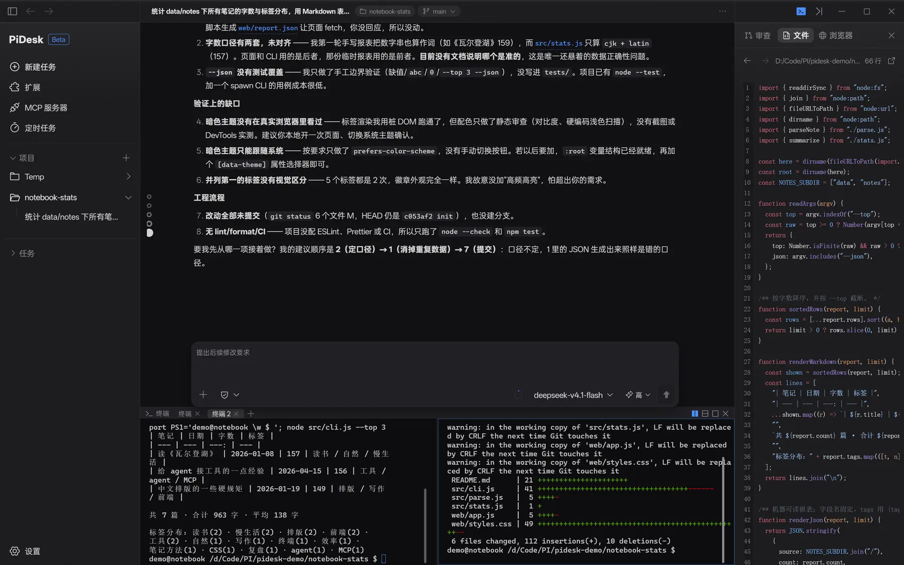
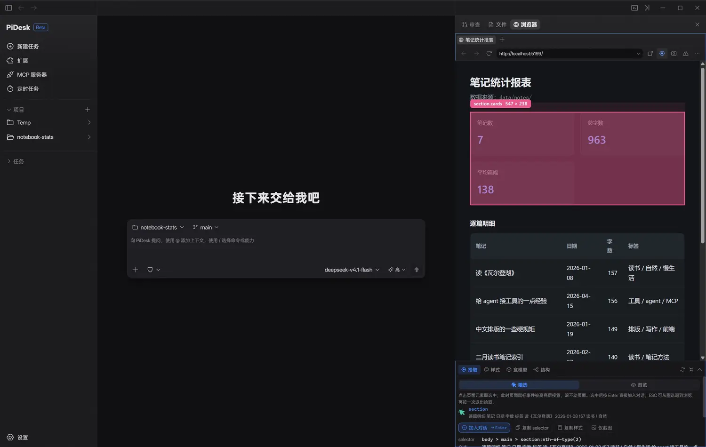
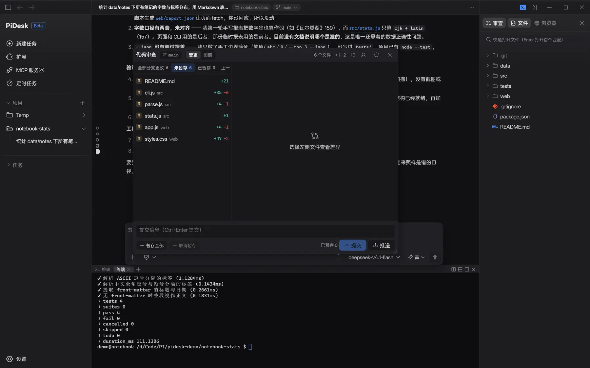
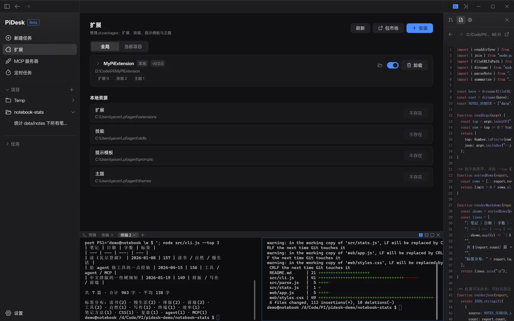
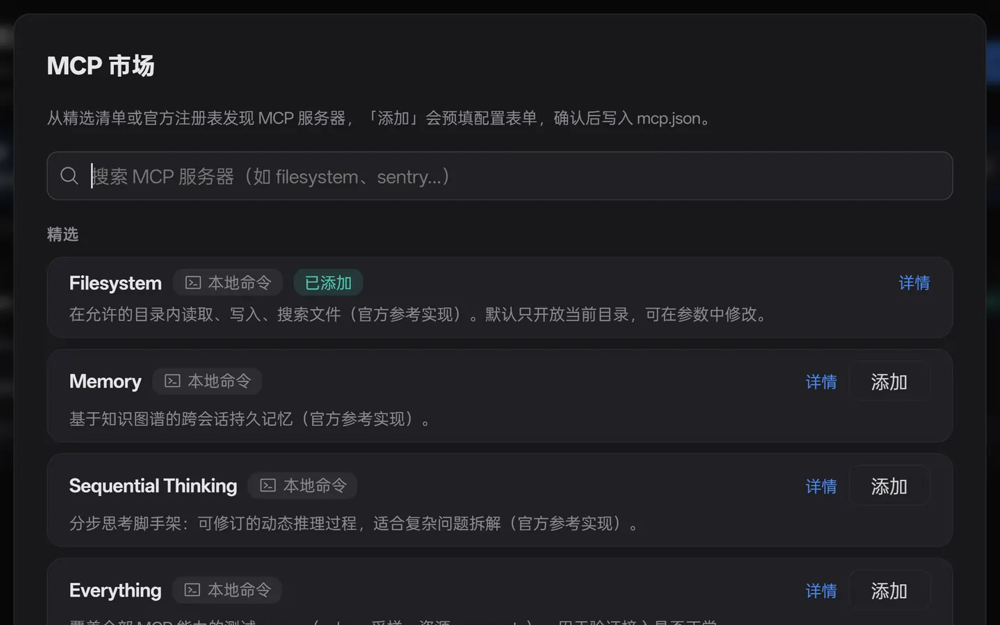

<div align="center">

# PiDesk

**A Windows desktop client for [pi](https://github.com/earendil-works/pi)**

[](https://pidesk-web.pages.dev/)
[](https://github.com/yokii89/Pi-Agent-Desktop/releases)


[](./LICENSE)



**English** ｜ [简体中文](./README.zh-CN.md) ｜ 🌐 **[Official website](https://pidesk-web.pages.dev/)**

</div>

> A desktop workbench powered by bundled pi-durable.

PiDesk is a Windows coding-agent workbench built on [pi-durable](https://github.com/earendil-works/pi). The runtime ships with the application and runs in an Electron utility process. Models, credentials, tools and extension lifetimes are managed by PiDesk; an external pi CLI is not required.

## Runtime and data

- The bundled Durable runtime owns the agent loop, tool execution and recoverable tasks. The desktop renders its output alongside projects, terminals, the browser and git changes.
- New conversations use Durable SQLite storage. Existing pi JSONL history remains available for viewing, copying and export; it cannot be resumed or modified as a Durable conversation.
- Configure an OpenAI-compatible gateway and model in Settings. Model credentials are stored with OS encryption by the desktop.
- Native extensions declare `pidesk.runtime` and run in the bundled utility process. Old coding-agent extensions and RPC execution are unsupported.
- MCP configuration is currently available for read-only inspection. Native MCP connections, authentication and tool registration remain to be implemented.

## Features

### Session area

- AI replies render as **document-flow Markdown** — GFM tables, numbered lists, inline code chips, one-click code block copy. No chat bubbles: a 200-line answer is a document, not twenty colored blocks.
- Tool calls collapse into compact status rows, and consecutive calls group into a summary header ("Ran 2 commands · Read 3 files"). Thinking folds into a single row until you expand it.
- **Parallel sessions**: 8 open Durable conversations by default, tunable from 1 to 32, sharing the bundled utility process. Switching preserves running work; hitting the ceiling refuses the new session.
- `@` file references as atomic tokens with read-only file chips; paste or drop images, attach any file.
- A **question rail** — one anchor per question, so you can jump straight back after fifty turns.
- Context usage next to the composer; a **per-turn file-edit summary** with undo and review on the same row; whole-session **Markdown or HTML export** (Markdown puts bodies in order, folds thinking and tool calls, and counts images rather than embedding them; both formats are generated from saved conversation history).
- Built-in plan mode and questionnaires use persistent Durable interactions. Native extensions can contribute desktop Views through their instance-owned client.
- Streaming is a ~32ms-batched event stream routed by `sessionId`, so parallel chats never bleed into each other.



*User bubble · run header (32s · 64.1K tokens) · collapsed thinking · "Ran 2 commands" summary rows · edit row with +1 −1*

### Workbench panels

Real components, not iframe placeholders: a real terminal on node-pty, a real embedded Chromium, a real git working-tree diff.

|  |  |
| :---: | :---: |
| **Files** — project tree, fuzzy quick-open, CodeMirror source viewing and editing, document previews, audio/video playback, and Mermaid diagrams. | **Terminal** — node-pty + xterm, tabs and side-by-side / stacked splits, cwd bound to the project. |

|  |  |
| :---: | :---: |
| **Browser** — import your cookie session, hover-highlight and select in pick mode, press Enter to drop the element into the composer, hot-edit styles, inspect. | **Review** — working-tree change list plus line-by-line diff, docked or floating, with stage / commit / push and rollbackable git snapshots. |

Audio and video previews include seeking, volume and playback speed, and pause when the file panel is hidden. Playback depends on the file's codec; unavailable files retain a system-open action. Standalone `.mmd` and `.mermaid` files open as diagrams, with zoom, image copy and a source view for editing.

Splitting reuses a terminal that is already running rather than starting another session, and hiding the panel never kills the pty — panes are a way of looking at terminals, not a way of killing them.

### Native extensions and resources

- **Extensions** — install native Durable packages globally or per project, with package and resource toggles. Package installation uses desktop-owned pnpm/Git operations and skips install scripts. Ship compiled ESM output with the package.
- **Skills and prompts** — declarative resources use the native loader. The managed skill catalog ships desktop-owned guidance for creating Durable extensions and skills.
- **MCP servers** — existing configuration is read-only until a native transport is implemented.
- **View SDK** (`@pidesk/view-sdk`) — a serializable View protocol with capability negotiation. Native factories receive their own authenticated View client, scoped to session, app or settings lifetime.
- **Scheduled tasks** and **usage statistics** (summary cards, daily / monthly trends, per-model breakdown).

|  |  |
| :---: | :---: |
| **Extensions** — pi packages plus per-resource toggles for extensions, skills, prompt templates and themes. | **MCP market** — official-registry search and curated one-click templates. |

### Desktop integration

zh-CN / en-US interfaces, light and dark themes, custom title bar, system tray, a one-shot startup animation with a replaceable logo, splash copy and font, Windows toasts with per-scenario sounds, optional GitHub sign-in for settings sync, and in-app auto-update from GitHub Releases — an **Update** button appears beside *Settings* when there is something new.

## Current scope

The application targets Windows 10/11. Durable is the only execution engine. Old JSONL history and declarative resources are retained as data, while the former CLI launcher, RPC session driver and shared CLI credential management have been removed. Native MCP integration and a published extension-factory SDK are not yet available. See the [migration records](./DURABLE-MIGRATION/README.md) for implementation and validation boundaries.

## Get started

1. Install a PiDesk build containing the bundled Durable runtime.
2. Configure your gateway URL, API key and model in Settings → Models.
3. Select a working directory and create a task. Configure the execution shell in Settings → Environment if needed.

Prefer to watch before you install? The [website](https://pidesk-web.pages.dev/#demo) has two walkthroughs captured from a running build: the full MCP flow, and picking a page element into the chat.

## Local development

Requirements: Windows 10/11 · Node.js ≥ 22.19 · [pnpm](https://pnpm.io) (locked by `packageManager`)

```bash
pnpm install   # run pnpm run rebuild:native first if node-pty needs an Electron ABI rebuild
pnpm dev       # tsc-compiled main process + Vite HMR renderer + automatic Electron restarts
pnpm dist      # NSIS installer and SHA-256 checksums into release/
```

| Script | Purpose |
| --- | --- |
| `pnpm dev` / `pnpm dev:renderer` | Full dev loop / Vite dev server only (renderer in a plain browser) |
| `pnpm build` / `pnpm start` | Build, then run the built output |
| `pnpm dist` / `pnpm release` | Package / bump version + tag to trigger the CI release |
| `pnpm typecheck` / `pnpm lint` | tsc strict / Biome format + lint |
| `pnpm test:view` / `pnpm test:sdk:coverage` | Protocol & SDK tests / SDK coverage |

Pushing a `v*` tag triggers GitHub Actions to build and publish to Releases. Release notes live in `release-notes/<tag>.md`, bilingual.

## Architecture

| Directory | Role |
| --- | --- |
| `src/main` | Electron main process: Durable host, terminal pty, embedded browser, git, window & settings |
| `src/agentRuntime` | Bundled ESM utility process: Durable sessions, native extensions and built-in tools |
| `src/preload` | `contextBridge` whitelisted API (`window.pidesk`) |
| `src/renderer` | React 19 UI: session area, panels, settings, extension view host |
| `src/shared` | IPC protocol, i18n message tables, shared types |
| `packages/view-sdk` | Extension-facing SDK, published as `@pidesk/view-sdk` |

Main ↔ renderer talk over `ipcMain.handle` (request-response, always `{ ok, data \| error }`) and `webContents.send` (pushes such as terminal and session streams). The renderer has no Node capabilities. Session pushes carry `sessionId`, so parallel Durable conversations share one channel.

## Extension development

Declare `pidesk.runtime` with `engine: "durable"`, `apiVersion: 1`, an id and compiled ESM entry. Its default factory receives an instance-scoped context and returns native agent definitions, commands and optional cleanup.

```ts
export default function createExtension(context) {
  return {
    commands: [{
      name: `${context.id}:review`,
      description: "Review workspace changes",
      expand: (args) => `Review ${args || "the current changes"}`,
    }],
  };
}
```

Factories declaring `views` use `context.views` and `context.contributions`; session identity and credentials do not come from environment discovery. App/settings hosts are explicitly declared user-scoped View lifetimes. See the [native extension contract](./assets/skills/plugin-creator/references/durable-extension.md) and [extension-host design](./DURABLE-MIGRATION/P3-EXTENSION-HOST.md). The factory contract is preview v1, not a published npm extension SDK.

## Documentation

- **[Official website](https://pidesk-web.pages.dev/)** — the visual tour, in zh-CN and en-US
- [AGENTS.md](./AGENTS.md) — development conventions, fixed tech stack, session-area rendering rules
- [@pidesk/view-sdk reference](./packages/view-sdk/README.md) — protocol, slots, capabilities, limits
- [pi](https://github.com/earendil-works/pi) — the agent PiDesk drives

## License

PiDesk is released under the [MIT License](./LICENSE). Third-party assets keep their own licenses — the file-type icons come from [vscode-jetbrains-icon-theme](https://github.com/peakoss/vscode-jetbrains-icon-theme) (JetBrains Design Resources, Apache 2.0), see [src/renderer/fileIcons/NOTICE.md](./src/renderer/fileIcons/NOTICE.md).
