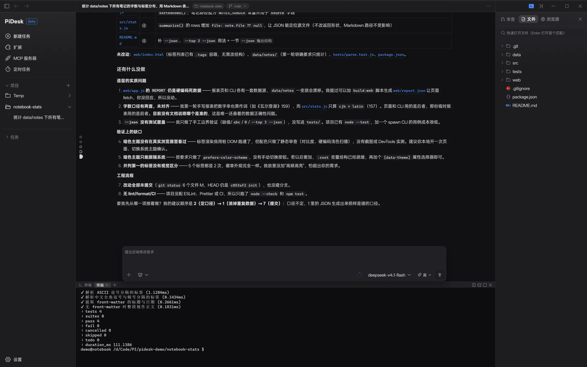
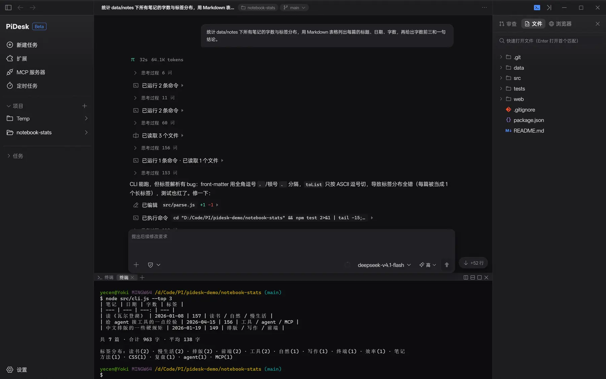
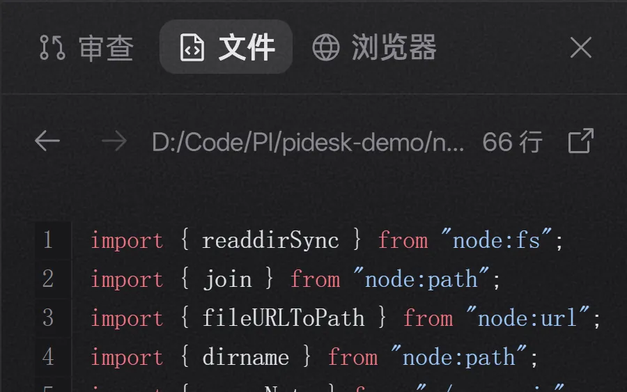
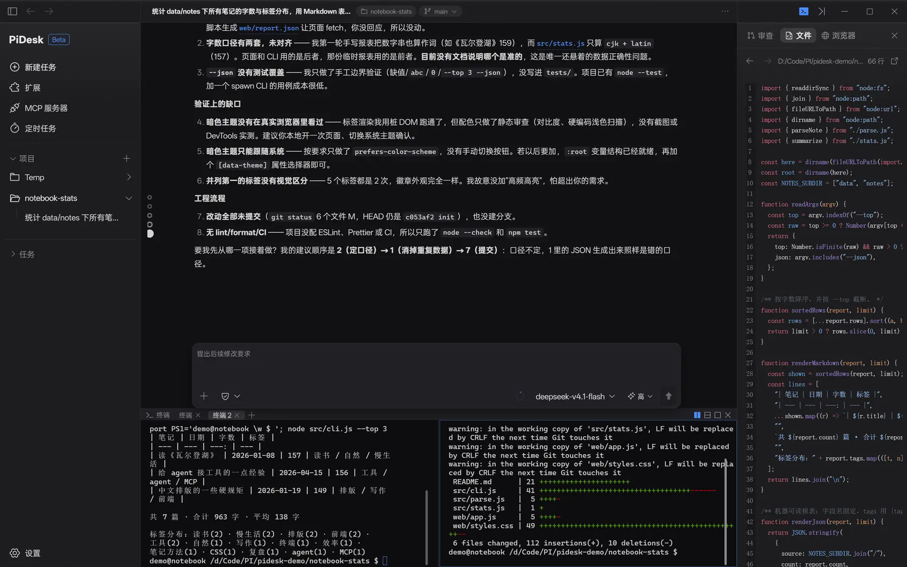
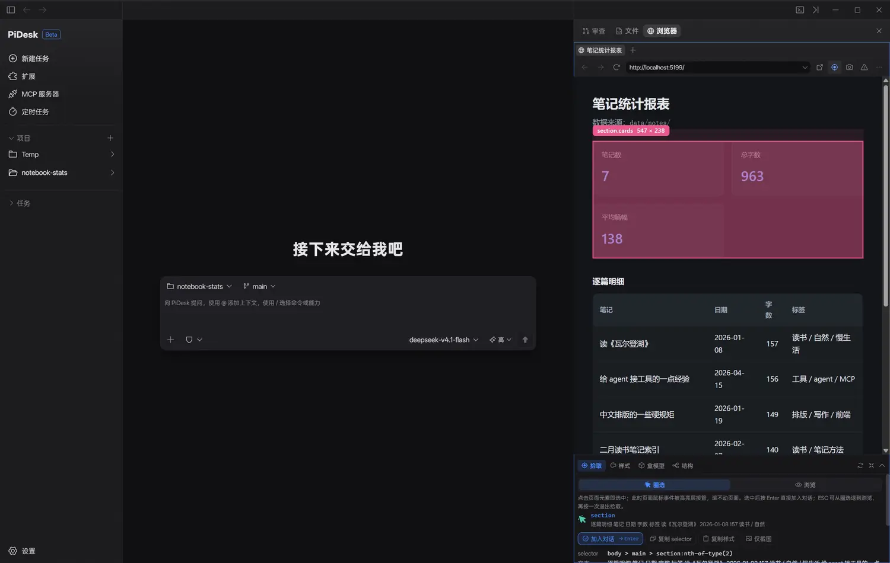
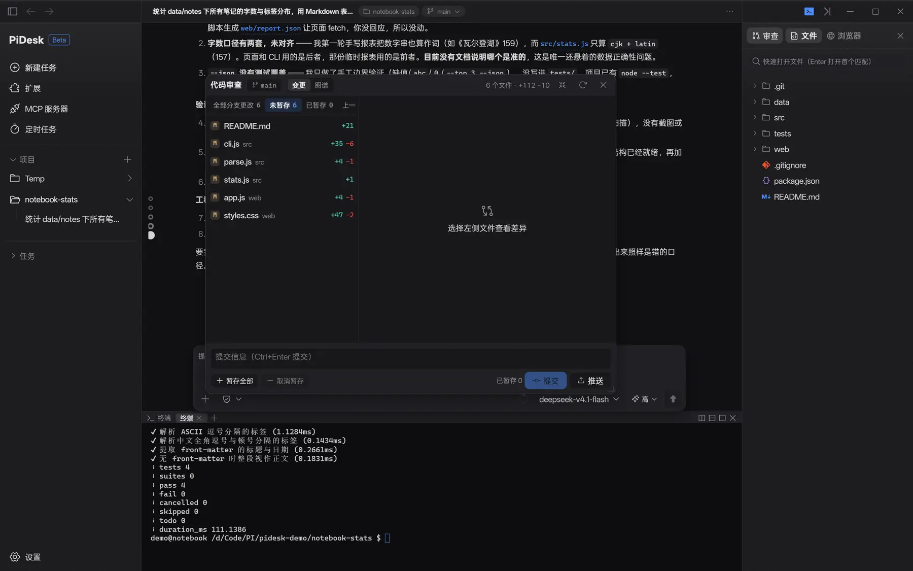
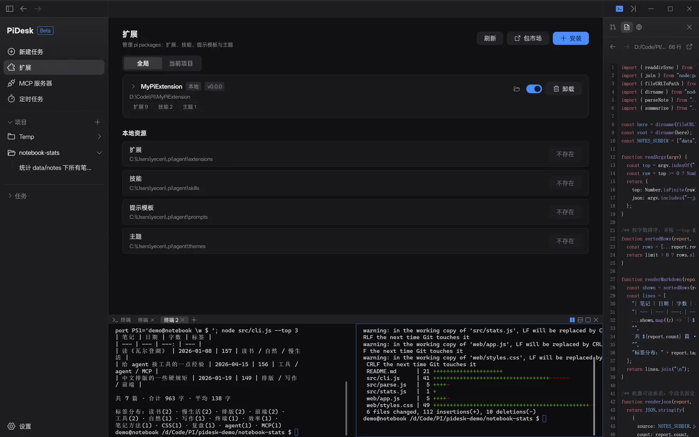
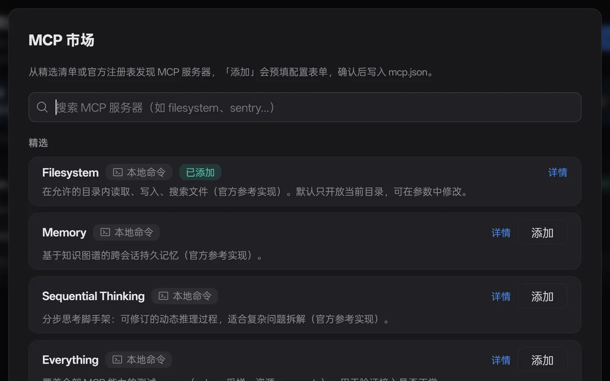

<div align="center">

# PiDesk

**[pi](https://github.com/earendil-works/pi) 的 Windows 桌面客户端**

[](https://pidesk-web.pages.dev/)
[](https://github.com/yokii89/Pi-Agent-Desktop/releases)


[](./LICENSE)



[English](./README.md) ｜ **简体中文** ｜ 🌐 **[官方网站](https://pidesk-web.pages.dev/)**

</div>

> 内置 pi-durable 的桌面工作台。

PiDesk 是基于 [pi-durable](https://github.com/earendil-works/pi) 的 Windows 编程工作台。运行时随应用内置，在 Electron utility process 中执行；模型、凭据、工具与扩展生命周期由 PiDesk 管理，无需安装外部 pi CLI。

## 运行时与数据

- 内置 Durable 负责 agent 循环、工具执行和可恢复任务；桌面工作台在会话旁提供项目、终端、浏览器与 git 变更。
- 新会话使用 Durable SQLite 存储。已有 pi JSONL 历史保留查看、复制和导出能力，不能续接或修改为 Durable 会话。
- 在设置中配置 OpenAI 兼容网关与模型；模型凭据由桌面通过系统加密存储。
- 原生扩展声明 `pidesk.runtime`，在内置 utility process 中运行。旧 coding-agent 扩展与 RPC 执行已不再支持。
- MCP 现阶段仅保留已有配置的只读查看；原生连接、鉴权与工具注册尚待接入。

## 功能

### 中央会话区

- AI 回复一律按**文档流 Markdown** 渲染：GFM 表格、编号列表、行内 code 芯片、代码块一键复制。不用聊天气泡——一次 200 行的回答是一篇文档，不该被切成 20 个色块。
- 工具调用压成一行紧凑状态行，连续调用自动折叠成摘要头（「已运行 2 条命令 · 已读取 3 个文件」）；思考过程默认收成一行，点开才展开。
- **多会话并行**：默认同时打开 8 个 Durable 会话，1–32 可调，共用内置 utility process；切换保留运行中的任务，超出上限时拒绝新会话。
- `@` 文件引用是原子化 token + 只读文件芯片；图片可粘贴、可拖放，任意文件都能作为附件。
- **问题导航分段栏**：每条提问一个跳转锚点，几十轮之后还能一步回到那一问。
- 输入框旁常驻上下文用量；**本轮文件编辑汇总**在同一行给出撤销与审阅；整篇会话可**导出成 Markdown 或 HTML**（Markdown 正文按原顺序排，思考与工具调用折成折叠块，图片只记数量不落盘；两种格式均从已保存历史生成）。
- 计划模式与问卷使用 Durable 持久交互；原生扩展通过实例专属客户端贡献桌面 View。
- 流式渲染走约 32ms 合批的事件流，渲染层按 `sessionId` 路由，并行会话互不串台。



*用户气泡 · 运行头（32s · 64.1K tokens）· 思考折叠 · 「已运行 2 条命令」摘要行 · 带 +1 −1 的编辑行*

### 工作台面板

都是真组件，不是 iframe 占位：node-pty 起的真终端、内嵌的真 Chromium、读 git working tree 的真 diff。

|  |  |
| :---: | :---: |
| **文件** —— 项目文件树、模糊搜索快速打开、CodeMirror 源码查看与就地编辑、文档预览、音视频播放与 Mermaid 图表。 | **终端** —— node-pty + xterm，多页签、左右或上下分屏，cwd 跟随当前项目。 |

|  |  |
| :---: | :---: |
| **浏览器** —— 导入登录态（Cookie）；拾取模式悬停高亮、点选展开检查器，按 Enter 把元素送进输入框；样式可热改。 | **审查** —— working tree 变更列表 + 逐行 diff，可停靠可浮窗，底部直接暂存 / 提交 / 推送，还有可回滚的 git 快照。 |

音视频预览支持拖动进度、音量与倍速，隐藏文件面板时暂停。实际能否播放取决于文件编码；无法播放时可用系统应用打开。独立 `.mmd` / `.mermaid` 文件默认显示图表，可放大查看、复制为图片，也可切换到源码进行编辑。

分屏会优先复用一个已经在跑的终端，而不是再开一个会话；隐藏面板也不会 kill pty——窗格是看终端的方式，不是关终端的方式。

### 原生扩展与资源

- **扩展** —— 全局或按项目安装 Durable 原生包，保留包级与资源级开关。安装由桌面自己的 pnpm/Git 服务执行，跳过安装脚本，扩展需提前提供编译后的 ESM 入口。
- **技能与模板** —— 声明式资源由原生加载器读取；受管技能目录随应用提供面向 Durable 的扩展与技能创作指南。
- **MCP 服务器** —— 原生传输接入前，已有配置仅供查看。
- **View SDK**（`@pidesk/view-sdk`） —— 可序列化 View 协议与能力协商；原生工厂获得独立鉴权的 View 客户端，生命周期显式区分会话、应用与设置。
- **定时任务**与**用量统计**（汇总卡片 + 按天/按月趋势 + 按模型明细），定时任务复用同一套会话引擎。

|  |  |
| :---: | :---: |
| **扩展页** —— pi packages，外加扩展 / 技能 / 提示模板 / 主题的资源级开关。 | **MCP 市场** —— 官方注册表搜索与精选清单一键预填。 |

### 桌面体验

中英双语界面、亮暗主题、自定义标题栏、系统托盘、可替换标识 / 文案 / 字体的开屏动画、Windows 桌面通知与分场景提示音、可选的 GitHub 登录同步设置、应用内自动更新（GitHub Releases）——有新版本时，侧栏「设置」旁边会出现一个 **「更新」** 按钮。

## 当前范围

应用面向 Windows 10/11，Durable 是唯一执行引擎。旧 JSONL 历史与声明式资源作为数据保留；旧 CLI 启动器、RPC 会话驱动与共享 CLI 凭据管理已经删除。原生 MCP 和独立发布的扩展工厂 SDK 尚未提供。实现与验收边界见 [迁移记录](./DURABLE-MIGRATION/README.md)。

## 开始使用

1. 安装包含内置 Durable 运行时的 PiDesk 构建。
2. 在设置 → 模型中配置网关地址、API Key 和模型。
3. 选择工作目录并新建任务；需要时在设置 → 环境中配置执行 Shell。

想先看再装？[官网](https://pidesk-web.pages.dev/#demo)有两段录自运行实例的演示：MCP 全流程，以及把网页元素拾取进对话。

## 本地开发

前置要求：Windows 10/11 · Node.js ≥ 22.19 · [pnpm](https://pnpm.io)（版本由 `packageManager` 字段锁定）

```bash
pnpm install   # node-pty 需要针对 Electron ABI 重编译时，先跑 pnpm run rebuild:native
pnpm dev       # 一条命令：tsc 编译主进程 + Vite HMR 渲染层 + 自动重启 Electron
pnpm dist      # 产出 Windows NSIS 安装包与 SHA-256 校验和（release/）
```

| 脚本 | 说明 |
| --- | --- |
| `pnpm dev` / `pnpm dev:renderer` | 完整开发链路 / 只起 Vite dev server（纯浏览器调渲染层） |
| `pnpm build` / `pnpm start` | 构建产物 / 以产物启动 |
| `pnpm dist` / `pnpm release` | 打包 / 本地 bump + tag 触发 CI 发版 |
| `pnpm typecheck` / `pnpm lint` | tsc strict 检查 / Biome 格式化与 Lint |
| `pnpm test:view` / `pnpm test:sdk:coverage` | 协议与 SDK 测试 / SDK 覆盖率 |

推送 `v*` tag 时，GitHub Actions 自动构建并发布到 Releases。更新日志在 `release-notes/<tag>.md`，中英双语。

## 架构一览

| 目录 | 职责 |
| --- | --- |
| `src/main` | Electron 主进程：Durable 宿主、终端 pty、内嵌浏览器、git、窗口与设置 |
| `src/agentRuntime` | 内置 ESM utility process：Durable 会话、原生扩展与工具 |
| `src/preload` | `contextBridge` 白名单 API（`window.pidesk`） |
| `src/renderer` | React 19 界面：会话区、面板、设置、扩展 View 宿主 |
| `src/shared` | IPC 协议、i18n 文案表、共享类型 |
| `packages/view-sdk` | 扩展端 SDK（发布为 `@pidesk/view-sdk`） |

主/渲染通信统一走 `ipcMain.handle`（请求-响应，一律返回 `{ ok, data \| error }`）与 `webContents.send`（推送，如终端流与会话事件流），渲染进程没有 Node 能力。会话推送必带 `sessionId`，并行 Durable 会话复用同一条通道。

## 扩展开发

通过 `pidesk.runtime` 声明 `engine: "durable"`、`apiVersion: 1`、id 和已编译 ESM 入口。默认工厂接收实例专属上下文，返回原生 agent 定义、命令及可选清理函数。

```ts
export default function createExtension(context) {
  return {
    commands: [{
      name: `${context.id}:review`,
      description: "审阅工作区改动",
      expand: (args) => `审阅 ${args || "当前改动"}`,
    }],
  };
}
```

声明 `views` 的工厂使用 `context.views` 和 `context.contributions`，不再从环境变量发现身份与凭据。应用/设置宿主必须由用户级包显式声明。完整规则见 [原生扩展契约](./assets/skills/plugin-creator/references/durable-extension.md) 和 [扩展宿主设计](./DURABLE-MIGRATION/P3-EXTENSION-HOST.md)。工厂契约仍为内部预览 v1，尚未发布为 npm 扩展 SDK。

## 文档

- **[官方网站](https://pidesk-web.pages.dev/)** —— 带截图与演示的完整导览（中英双语）
- [AGENTS.md](./AGENTS.md) —— 开发约定、固定技术栈、中央会话区渲染规则
- [@pidesk/view-sdk 参考](./packages/view-sdk/README.md) —— 协议、槽位、能力协商、限额
- [pi](https://github.com/earendil-works/pi) —— PiDesk 驱动的那个 agent

## 开源协议

PiDesk 以 [MIT](./LICENSE) 协议开源。仓库内第三方资产沿用其自身许可：文件类型图标源自 [vscode-jetbrains-icon-theme](https://github.com/peakoss/vscode-jetbrains-icon-theme)（JetBrains Design Resources，Apache 2.0），许可见 [src/renderer/fileIcons/NOTICE.md](./src/renderer/fileIcons/NOTICE.md)。
