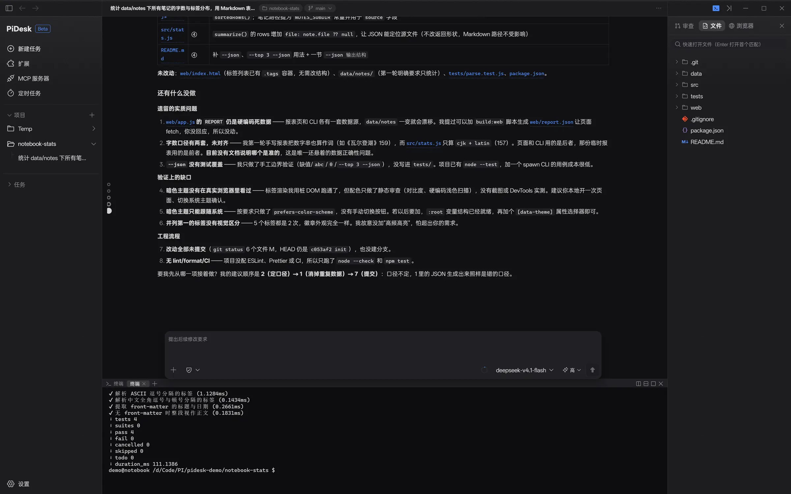
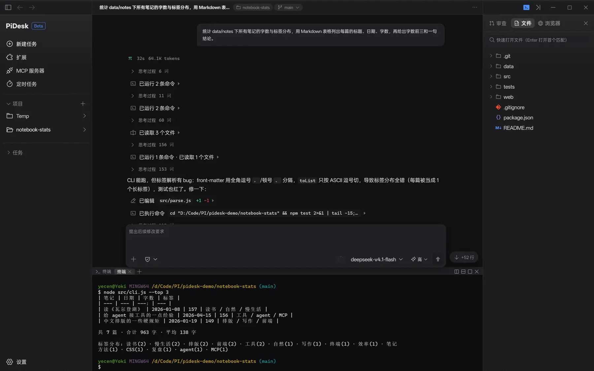
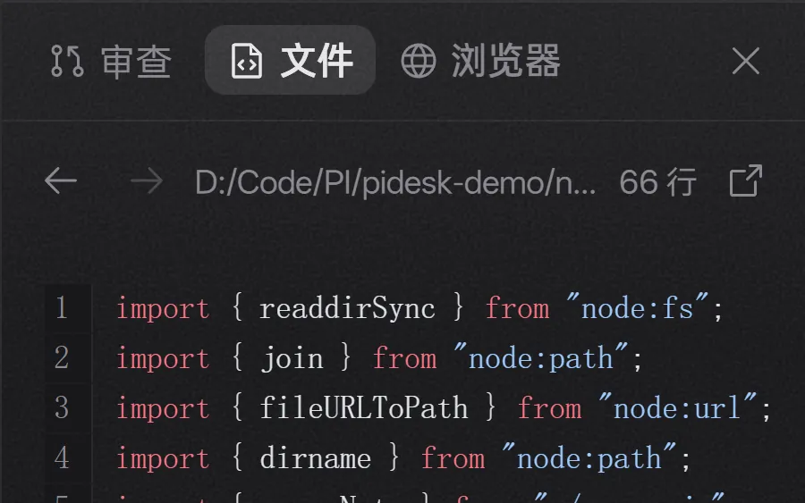
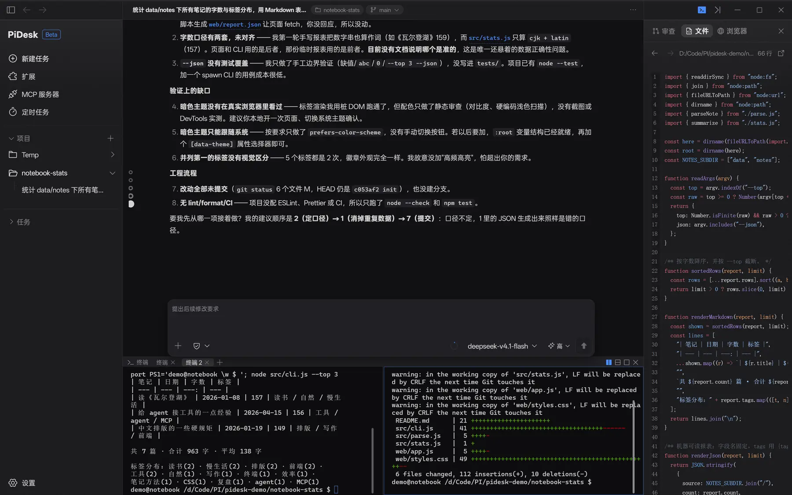
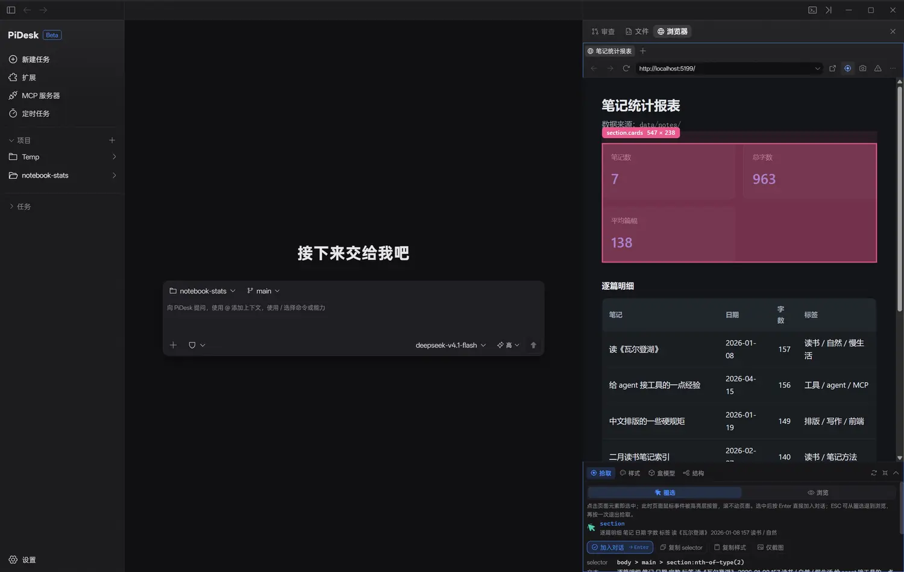
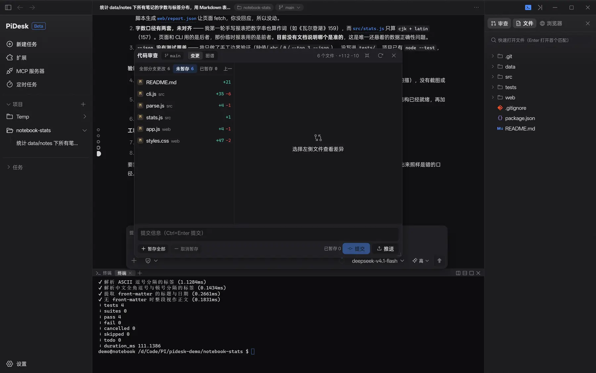
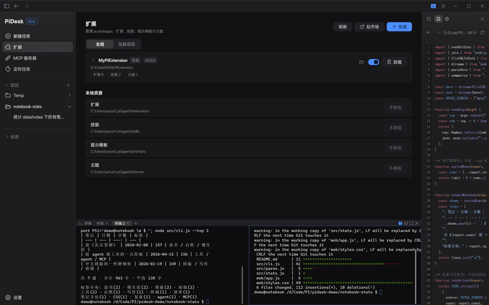
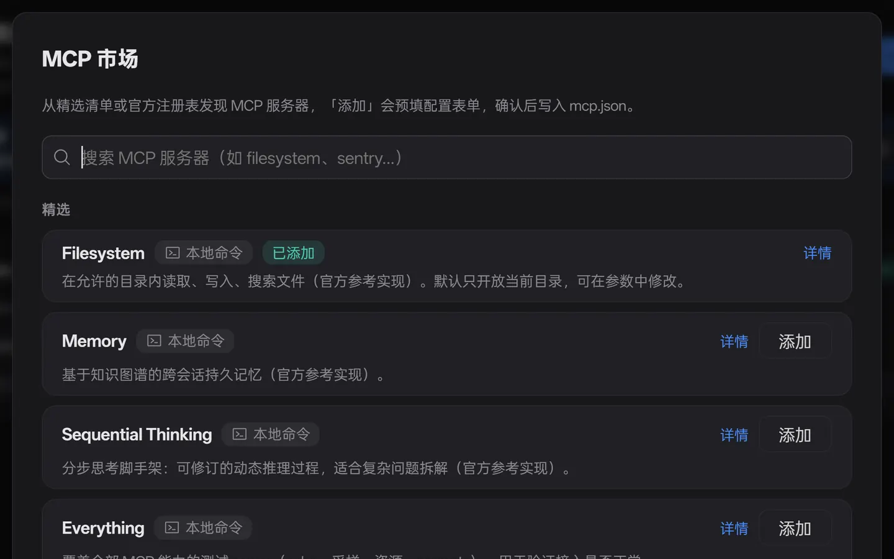
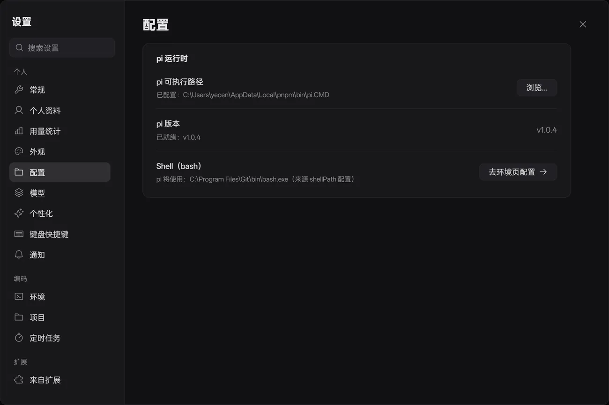

<div align="center">

# PiDesk

**[pi](https://github.com/earendil-works/pi) 的 Windows 桌面客户端**

[](https://pidesk-web.pages.dev/)
[](https://github.com/yokii89/Pi-Agent-Desktop/releases)


[](./LICENSE)



[English](./README.md) ｜ **简体中文** ｜ 🌐 **[官方网站](https://pidesk-web.pages.dev/)**

</div>

> 很多 agent 客户端，这一个跑在你的 pi 上。

PiDesk 是开源 coding agent [pi](https://github.com/earendil-works/pi) 的 Windows 桌面客户端。它不重新实现 agent：pi 以 `--mode rpc` 子进程运行（stdio 上的 JSONL），PiDesk 负责驱动它。会话历史始终是 pi 原生的 JSONL 文件，终端里的 pi 与 PiDesk 里的 pi 是同一份数据。**[官方网站](https://pidesk-web.pages.dev/)** 有带截图的完整导览和两段真操作演示。

## 只做客户端该做的事

- agent 循环、模型鉴权、上下文压缩、工具执行，全部发生在 pi 进程里。PiDesk 补上的是它们外面的桌面工作台：把事件流渲染成可读的文档，把项目、终端、浏览器和 git 变更摆在旁边。
- **会话历史始终是 pi 原生文件。** 不复制正文、不做二次同步、不存在「两份数据谁为准」；PiDesk 只另存标题、归档、置顶这类标记。卸载 PiDesk，你的会话在终端里照样打得开。
- **MCP 配置写在 pi 的用户级 `mcp.json`**，与 CLI 共用一份。
- **没有 PiDesk 账号，也没有 PiDesk 的模型额度。** 模型鉴权由 pi 自身配置承担；GitHub 登录是可选项，用来同步设置。
- pi 升级协议，PiDesk 不需要同步实现一份。

## 功能

### 中央会话区

- AI 回复一律按**文档流 Markdown** 渲染：GFM 表格、编号列表、行内 code 芯片、代码块一键复制。不用聊天气泡——一次 200 行的回答是一篇文档，不该被切成 20 个色块。
- 工具调用压成一行紧凑状态行，连续调用自动折叠成摘要头（「已运行 2 条命令 · 已读取 3 个文件」）；思考过程默认收成一行，点开才展开。
- **多会话并行**：默认 8 个 pi 进程同时存活，1–32 可调；切换绝不杀进程，超出上限时是新会话启动失败，而不是挤掉旧会话。
- `@` 文件引用是原子化 token + 只读文件芯片；图片可粘贴、可拖放，任意文件都能作为附件。
- **问题导航分段栏**：每条提问一个跳转锚点，几十轮之后还能一步回到那一问。
- 输入框旁常驻上下文用量；**本轮文件编辑汇总**在同一行给出撤销与审阅；整篇会话可**导出成 Markdown 或 HTML**（Markdown 正文按原顺序排，思考与工具调用折成折叠块，图片只记数量不落盘；HTML 走 pi 原生导出）。
- 访问模式：内置「完全访问」，扩展可通过 SDK 注册自己的模式（计划模式就是一个扩展示例）。
- 流式渲染走约 32ms 合批的事件流，渲染层按 `sessionId` 路由，并行会话互不串台。



*用户气泡 · 运行头（32s · 64.1K tokens）· 思考折叠 · 「已运行 2 条命令」摘要行 · 带 +1 −1 的编辑行*

### 工作台面板

都是真组件，不是 iframe 占位：node-pty 起的真终端、内嵌的真 Chromium、读 git working tree 的真 diff。

|  |  |
| :---: | :---: |
| **文件** —— 项目文件树 + Shiki 语法高亮只读预览 + 模糊搜索快速打开。改文件这件事交给 agent。 | **终端** —— node-pty + xterm，多页签、左右或上下分屏，cwd 跟随当前项目。 |

|  |  |
| :---: | :---: |
| **浏览器** —— 导入登录态（Cookie）；拾取模式悬停高亮、点选展开检查器，按 Enter 把元素送进输入框；样式可热改。 | **审查** —— working tree 变更列表 + 逐行 diff，可停靠可浮窗，底部直接暂存 / 提交 / 推送，还有可回滚的 git 快照。 |

分屏会优先复用一个已经在跑的终端，而不是再开一个会话；隐藏面板也不会 kill pty——窗格是看终端的方式，不是关终端的方式。

### pi 的生态，装进面板里

PiDesk 不制造生态，只做生态的宿主。

- **扩展** —— 管理 pi packages：安装 / 卸载 / 启停，分全局与当前项目，扩展、技能、提示模板、主题都能按资源级开关。
- **MCP 服务器** —— 配置增删改、状态探测、热重载进正在跑的会话；市场支持官方注册表搜索 + 精选清单一键预填，不用手抄 JSON。会话区用同一套状态行承接 `mcp__*` 调用。（需 pi ≥ 0.99.0。）
- **View SDK**（`@pidesk/view-sdk`） —— 可序列化的 View 协议 + 宿主能力协商 + 软降级：扩展声明要装在哪个槽位、需要什么能力，宿主逐项裁决，装不下就按声明降级。八个挂载槽位，pi 本体零改动。
- **定时任务**与**用量统计**（汇总卡片 + 按天/按月趋势 + 按模型明细），定时任务复用同一套会话引擎。

|  |  |
| :---: | :---: |
| **扩展页** —— pi packages，外加扩展 / 技能 / 提示模板 / 主题的资源级开关。 | **MCP 市场** —— 官方注册表搜索与精选清单一键预填。 |

### 桌面体验

中英双语界面、亮暗主题、自定义标题栏、系统托盘、可替换标识 / 文案 / 字体的开屏动画、Windows 桌面通知与分场景提示音、可选的 GitHub 登录同步设置、应用内自动更新（GitHub Releases）——有新版本时，侧栏「设置」旁边会出现一个 **「更新」** 按钮。

## 我们刻意没做的六件事

客户端不该变成第二个 agent。下面每一条都是「本来可以做，但做了就会和 pi 抢职责」。

| 没做 | 为什么 |
| --- | --- |
| 会话正文副本 | 正文始终是 pi 原生 JSONL。PiDesk 只另存标记，外加整篇导出成 Markdown 或 HTML 的能力。 |
| 内置 pi | 安装包里没有 agent。你在设置里指向本机的 pi 可执行文件，PiDesk 探测版本并启动它。 |
| 账号体系 | 模型鉴权归 pi。不登录 GitHub 也完全能用。 |
| 聊天气泡 UI | agent 的输出本来就是文档。 |
| 重造 agent 能力 | 子代理、权限门、沙箱属于 pi 的扩展生态。PiDesk 负责把它们渲染出来，并让扩展通过 SDK 注册视图与访问模式。 |
| 跨平台 | 只做 Windows 10/11。省下的预算全花在桌面集成上：托盘、原生通知、分场景提示音、自动更新。 |

## 开始使用

1. 安装 pi CLI —— `npm install -g @earendil-works/pi-coding-agent`，并在 pi 里配好模型鉴权。
2. 从 [Releases](https://github.com/yokii89/Pi-Agent-Desktop/releases) 下载 NSIS 安装包（附 SHA-256 校验和）。
3. 首次启动在设置里指定 pi 可执行文件路径、选择工作目录，然后新建任务。



*设置 → 配置：指向本机的 pi 可执行文件，PiDesk 会探测版本并报告就绪状态。*

想先看再装？[官网](https://pidesk-web.pages.dev/#demo)有两段录自运行实例的演示：MCP 全流程，以及把网页元素拾取进对话。

## 本地开发

前置要求：Windows 10/11 · Node.js ≥ 20 · [pnpm](https://pnpm.io)（版本由 `packageManager` 字段锁定）· pi CLI

```bash
pnpm install   # node-pty 需要针对 Electron ABI 重编译时，先跑 pnpm run rebuild:native
pnpm dev       # 一条命令：tsc 编译主进程 + Vite HMR 渲染层 + 自动重启 Electron
pnpm dist      # 产出 Windows NSIS 安装包与 SHA-256 校验和（release/）
```

| 脚本 | 说明 |
| --- | --- |
| `pnpm dev` / `pnpm dev:renderer` | 完整开发链路 / 只起 Vite dev server（纯浏览器调渲染层） |
| `pnpm build` / `pnpm start` | 构建产物 / 以产物启动 |
| `pnpm dist` / `pnpm release` | 打包 / 本地 bump + tag 触发 CI 发版 |
| `pnpm typecheck` / `pnpm lint` | tsc strict 检查 / Biome 格式化与 Lint |
| `pnpm test:view` / `pnpm test:sdk:coverage` | 协议与 SDK 测试 / SDK 覆盖率 |

推送 `v*` tag 时，GitHub Actions 自动构建并发布到 Releases。更新日志在 `release-notes/<tag>.md`，中英双语。

## 架构一览

| 目录 | 职责 |
| --- | --- |
| `src/main` | Electron 主进程：pi RPC 驱动、终端 pty、内嵌浏览器、git、MCP、窗口与设置 |
| `src/preload` | `contextBridge` 白名单 API（`window.pidesk`） |
| `src/renderer` | React 19 界面：会话区、面板、设置、扩展 View 宿主 |
| `src/shared` | IPC 协议、i18n 文案表、共享类型 |
| `packages/view-sdk` | 扩展端 SDK（发布为 `@pidesk/view-sdk`） |

主/渲染通信统一走 `ipcMain.handle`（请求-响应，一律返回 `{ ok, data \| error }`）与 `webContents.send`（推送，如终端流与会话事件流），渲染进程没有 Node 能力。会话推送必带 `sessionId`，多个 pi 进程复用同一条通道。

## 扩展开发

```bash
npm install @pidesk/view-sdk
```

```ts
import { connectDesktopView, viewOnDesktop } from "@pidesk/view-sdk";

const desktop = connectDesktopView(); // 同步探测环境变量，socket 懒连接
if (desktop) {
  await viewOnDesktop(desktop, {
    title: "选择模型",
    root: { type: "list", id: "model", items: [{ value: "a", label: "A" }] },
    actions: [{ id: "cancel", label: "取消", kind: "submit", variant: "ghost" }],
  });
}
```

挂载槽位：`modal` · `stream` · `widget` · `panel` · `sidebar` · `header` · `settings` · `access-mode`。在纯终端 pi 里跑时环境变量探测返回 `null`，扩展自动退回自己的 TUI——同一个包在两种宿主下都能用。

## 文档

- **[官方网站](https://pidesk-web.pages.dev/)** —— 带截图与演示的完整导览（中英双语）
- [AGENTS.md](./AGENTS.md) —— 开发约定、固定技术栈、中央会话区渲染规则
- [@pidesk/view-sdk 参考](./packages/view-sdk/README.md) —— 协议、槽位、能力协商、限额
- [pi](https://github.com/earendil-works/pi) —— PiDesk 驱动的那个 agent

## 开源协议

PiDesk 以 [MIT](./LICENSE) 协议开源。仓库内第三方资产沿用其自身许可：文件类型图标源自 [vscode-jetbrains-icon-theme](https://github.com/peakoss/vscode-jetbrains-icon-theme)（JetBrains Design Resources，Apache 2.0），许可见 [src/renderer/fileIcons/NOTICE.md](./src/renderer/fileIcons/NOTICE.md)。
